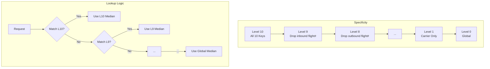

---

layout: post
title: "The Art of the Graceful Fallback: Designing a Bulletproof YQ Cache in Athena"
description: "How to stop firefighting API hiccups and build a statistically sound, multi-level YQ cache with rollups, shrinkage, and deep observability in AWS Athena."
date: 2025-08-27 10:00:00 +0000
categories: data-platform
tags: [athena, presto, sql, caching, data-engineering]

---

### The 3 AM Alert We All Dread

It’s 3 AM, and your on-call dashboard is a sea of red. A critical pricing service is down. For most of the company, it’s a temporary glitch. For the finance team, who needs to close the books, it’s a disaster. They don’t need a perfect real-time number; they need a **defensible number, right now**.

This is a story about how we went from panicked, ad-hoc queries to a principled, multi-level caching system for airline YQ taxes (fuel surcharges). It’s a system designed to fail gracefully, preferring hyper-specific data when available but seamlessly falling back to broader, stable estimates when necessary. It's fast, explainable, and rigorous enough to stand up to scrutiny—all built with the humble power of SQL in AWS Athena.

**TL;DR: The Core Recipe**

1.  **Normalize Your Keys:** Aggressively standardize your join keys (`NULL` → `''`, `CAST AS VARCHAR`). This prevents maddening join failures across different data sources.
2.  **Build a Hierarchy in One Shot:** Use `GROUP BY ROLLUP` across your dimensions (e.g., carrier, cabin, route) to pre-calculate YQ medians at every level of specificity, from a full 10-key match down to a global median.
3.  **Implement a Cascade Lookup:** At query time, try to find a match at the most specific level first (Level 10). If it's not there or the data is too sparse, fall back to Level 9, then Level 8, and so on. The first hit wins.
4.  **Add Statistical Guardrails:** Don't trust tiny samples. Enforce a minimum cell size. For sparse groups, use hierarchical shrinkage to "borrow strength" from their more stable parent levels.
5.  **Obsess Over Observability:** Monitor everything. Which level is serving the most traffic? What's the error rate at each level? This is how you tune your cache from good to great.

---

### Why YQ is a Caching Nightmare

Estimating the YQ fuel surcharge is tricky. In the wild, it’s:

  * **Long-tailed:** Most values are predictable, but a few are astronomically high, capable of poisoning any simple average. ✈️
  * **Highly Segmented:** The YQ for a first-class ticket on Carrier A from JFK to LHR is a completely different beast than an economy ticket on Carrier B from LAX to SFO.
  * **Temporally Sensitive:** What was true last quarter might not be true today.
  * **Sparse:** The most granular levels (e.g., a specific flight number on a specific day) might only have a handful of data points, making them unreliable.

Our first attempt was a simple `GROUP BY` on a few keys, calculating the `AVG(yq)`. It failed spectacularly. A single bad data point could skew the average for thousands of future lookups. We needed something more robust.

**Our weapon of choice? The median.** The median has a 50% breakdown point, meaning you can corrupt nearly half your data, and it won't budge. It laughs in the face of outliers. Athena/Presto's `approx_percentile(yq, 0.5)` is the perfect tool for this—it’s memory-efficient, fast, and exactly what we need for a stable estimate.

---

### The Core Idea: A Cascade of Experts

Imagine you need an answer to a very specific question. You’d first ask the world's leading expert on that exact topic. If they're unavailable, you ask an expert in the broader field. If they can't help, you ask a well-read colleague, and finally, you might just rely on the global "common knowledge."

Our cache works the same way. We define a hierarchy of 10 dimensions, ordered from most important to most granular.

This "cascade" ensures we always use the most relevant, specific information available that meets our quality standards.

The formula for our final prediction, $\\hat{y}(x)$, for a given flight $x$ is the median from the most specific level, $L^\*$, that is trustworthy:

$$\hat{y}(x) = \widehat{Q}_{0.5}(L^*, x), \quad \text{where } L^* = \max\{\, L \in \{0, \dots, 10\}\;:\; \text{cell}(L,x)\ \text{passes quality checks} \,\}$$

Let's look at the fallback chain we designed, which is the heart of our strategy.

#### Our v3 Fallback Strategy: The Order is Everything

The magic of `GROUP BY ROLLUP(k1, k2, ..., k10)` is that it creates the entire fallback chain in a single pass. But this means **the order of your keys *is* your fallback strategy**. You must choose it wisely. We put high-signal, low-cardinality keys first and sparse, volatile keys last.

Here is our chosen hierarchy, from most specific to most general:



Choosing this order was a mix of business intuition and data:

1.  **Business Priors:** Carrier and Cabin are fundamental drivers of price. They go first. Flight numbers are noisy and sparse. They go last.
2.  **Signal vs. Sparsity:** We measured the error reduction from adding each key. A key like `outboundoriginairportcode` has huge signal. But a key like `outboundflightnumber`, while having signal, is so high-cardinality that it would create too many tiny, untrustworthy groups. It gets dropped sooner.

---

### Making it Bulletproof: Statistical Guardrails 

A naive implementation will still fail in the real world. Here are the three guardrails that make our cache trustworthy.

#### 1\. The "Are You Sure?" Check: Minimum Cell Size

Would you trust an estimate based on a single data point? Neither would we. We introduced a `n_min` threshold (e.g., 30 data points). If a cell at Level $L$ has fewer than 30 points, we consider it unreliable and immediately fall back to Level $L-1$, even if it exists.

`CASE WHEN n >= 30 THEN median_yq ELSE NULL END`

#### 2\. The Stabilizer: Hierarchical Shrinkage

What about a cell with 35 data points? It passes our `n_min` check, but it's still not as trustworthy as a parent group with 10,000 data points. This is where **hierarchical shrinkage** comes in. It's a fancy term for a simple, powerful idea: *for uncertain estimates, pull them slightly toward their more stable parent average.*

The formula for the "shrunken" median $\\tilde{Q}\_{0.5}$ is a weighted average:

$$\tilde{Q}_{0.5}(L,x) \;=\; w_L(x)\,\widehat{Q}_{0.5}(L,x) \;+\; \big(1-w_L(x)\big)\,\widehat{Q}_{0.5}(L-1,x)$$

The weight $w\_L(x)$ is based on the cell's sample size, $n\_L(x)$:

$$w_L(x) \;=\; \frac{n_L(x)}{n_L(x)+k}$$

Here, $k$ is a "skepticism" parameter. A higher $k$ (e.g., 100) means you need a lot of data before you fully trust the local estimate. This simple technique dramatically reduces error for sparse markets by borrowing strength from the broader context.

#### 3\. The Freshness Check: Time Windows

To avoid using stale data, the cache is rebuilt daily on a rolling 60-day window of training data. This balances the need for fresh data with the need for a large enough sample size to be stable.

---

### Show Me the Code: A Minimal SQL Blueprint

You don't need a complex pipeline to build this. Here’s the conceptual SQL that powers the whole system.

**Step 1: Create the Multi-Level Cache Table with `ROLLUP`**

```sql
-- Create the cache with all levels of specificity
CREATE TABLE yq_cache_v3 AS
WITH normalized_source AS (
  SELECT
    -- IMPORTANT: Normalize every key to avoid NULL-related join bugs!
    CAST(COALESCE(validatingcarrier, '') AS VARCHAR) AS k1_carrier,
    CAST(COALESCE(cabin, '') AS VARCHAR) AS k2_cabin,
    -- ... repeat for all 10 keys ...
    CAST(tax_yq_amount AS DOUBLE) AS yq
  FROM raw_flight_data
  WHERE tax_yq_amount IS NOT NULL AND tax_yq_amount > 0
)
SELECT
  k1_carrier,
  k2_cabin,
  -- ... other 8 keys ...

  -- Calculate the specificity level. 10 is most specific, 0 is global.
  10 - (
    grouping(k1_carrier) + grouping(k2_cabin) + -- ... + grouping(k10)
  ) AS cache_level,

  -- Calculate the robust median and the sample size
  approx_percentile(yq, 0.5) AS median_yq,
  count(*) AS n
FROM normalized_source
GROUP BY ROLLUP (
  k1_carrier, k2_cabin, k3_origin, -- ... all 10 keys in strategic order
);
```

**Step 2: Perform the Cascading Lookup with `COALESCE`**

At query time, you perform a series of `LEFT JOIN`s against the cache, one for each level, and use `COALESCE` to pick the first non-null result.

```sql
-- At lookup time, perform the cascading join
WITH request_to_lookup AS (
  -- Normalize keys exactly as you did in the cache creation!
  SELECT ...
)
SELECT
  req.*,
  -- COALESCE is the magic that implements the fallback chain
  COALESCE(
    l10.median_yq, l9.median_yq, l8.median_yq, l7.median_yq,
    l6.median_yq, l5.median_yq, l4.median_yq, l3.median_yq,
    l2.median_yq, l1.median_yq, l0.median_yq
  ) AS estimated_yq,
  
  -- Also return which level provided the answer for observability
  COALESCE(l10.cache_level, l9.cache_level, ..., 0) AS cache_hit_level

FROM request_to_lookup req
LEFT JOIN yq_cache_v3 l10 ON (req.k1 = l10.k1 AND ... AND req.k10 = l10.k10 AND l10.cache_level = 10 AND l10.n >= 30)
LEFT JOIN yq_cache_v3 l9  ON (req.k1 = l9.k1  AND ... AND req.k9  = l9.k9  AND l9.cache_level = 9  AND l9.n >= 30)
-- ... repeat joins for all levels down to L1 ...
LEFT JOIN yq_cache_v3 l0  ON (l0.cache_level = 0);
```

---

### Keeping Your Cache Honest: Observability is Key

You can't improve what you don't measure. Building the cache is only half the battle. We built a dashboard to track its performance, focusing on four key metrics:

1.  **Hit Rate by Level:** What percentage of lookups are being resolved at each level? This tells us if our key ordering is right. A massive pile-up at Level 0 (global) means our higher levels are too sparse.

2.  **Error (MAE/MAPE) by Level:** Is our assumption that "more specific is more accurate" actually true? We plot the Mean Absolute Error against the ground truth for each level. We expect to see a beautiful downward slope.

3.  **Coverage of `n_min`:** How many potential cells are we discarding because they are too small? This helps us tune the `n_min` threshold.

4.  **Drift Over Time:** We monitor the median YQ for key segments (like top carriers) to detect real-world price changes and ensure our cache is keeping up.

When we first launched, we saw that dropping the flight numbers (moving from Level 10 to Level 8) immediately increased our coverage from 10% to nearly 50% with only a tiny increase in error. Adding shrinkage `(k=100)` cut the median absolute error on our sparse long-tail markets by **over 15%**. These insights were only possible because we measured everything.

### Final Takeaways

This multi-level caching system has become a workhorse for our data platform. It's reliable, explainable, and has saved us from countless fire drills.

  * **Median + Rollup is a Power Combo:** One pass, multiple levels of specificity, and extreme resilience to outliers.
  * **Your Dimension Order *is* Your Strategy:** Choose it with data, debate it with your team, and monitor it relentlessly.
  * **Trust, but Verify:** Statistical guardrails like minimum cell size and shrinkage aren't optional extras; they are core to building a reliable system.
  * **Normalize Everything. Always.** Inconsistent keys are the \#1 source of silent, painful bugs in data pipelines. Be disciplined.

This approach isn't limited to YQ taxes. It's a general pattern for providing robust estimates for any sparse, long-tailed, highly-segmented metric when the primary source is unavailable. It’s the art of the graceful fallback.
